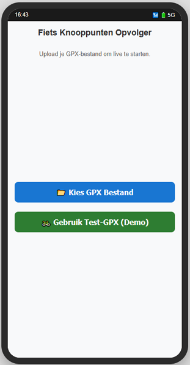
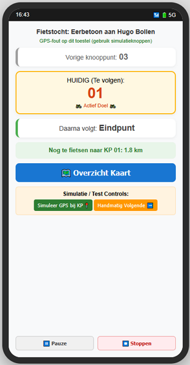
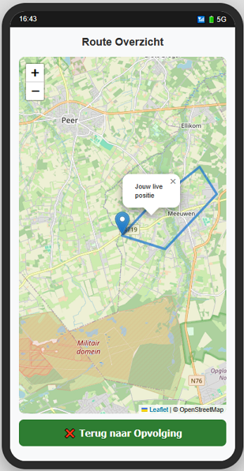
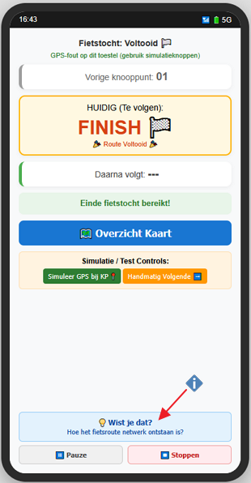

# 🚲 Fiets Knooppunten Opvolger (PWA)

Een slimme, webgebaseerde **Progressive Web App (PWA)** voor het live navigeren langs fietsknooppunten. De app maakt gebruik van GPX-bestanden, live GPS-tracking, gesproken instructies en biedt historische achtergrondinformatie over het ontstaan van het knooppuntennetwerk.

---

## 🌟 Belangrijkste Functies

* **GPX Bestand Inladen:** Upload eenvoudig een `.gpx`-bestand van je route. Inclusief automatische bestandsvalidatie.
* **Live GPS-Tracking:** Berekent in real-time de afstand tot het actieve knooppunt.
* **Gesproken Begeleiding (TTS):** Waarschuwt spraakgestuurd bij het naderen van een knooppunt en meldt het volgende nummer of het eindpunt.
* **Geïntegreerde Overzichtskaart:** Bekijk de volledige route op een interactieve Leaflet.js / OpenStreetMap kaart.
* **Pauze & Hervat:** Onderbreek de navigatie op elk moment voor een tussenstop zonder dat de app doornummert.
* **Offline & PWA Ondersteuning:** Installeerbaar als app op het startscherm van Android en iOS (Safari).
* **"Wist Je Dat?" Historische Context:** Ontdek na de finish het boeiende verhaal over mijningenieur **Hugo Bollen** en hoe het knooppuntensysteem in Belgisch Limburg werd uitgevonden.

> ℹ️ **Internetverbinding:** De app en GPS-navigatie werken via de PWA-technologie grotendeels offline. Voor het inladen van de kaarttegels (OpenStreetMap / Leaflet) is wel een actieve internetverbinding (3G/4G/5G of Wi-Fi) vereist.
---

## 📱 Live App Gebruiken & Installeren

De app is live te gebruiken via GitHub Pages:  
👉 **[Open de Fiets Knooppunten App](https://verony-makesit.github.io/fiets-knooppunten-app/)** 

### Installeren op Smartphone (PWA)

* **Android (Chrome):** Open de link ➔ Tik op de drie puntjes ➔ Kies **"App installeren"** of *"Toevoegen aan startscherm"*.
* **iOS (Safari):** Open de link in Safari ➔ Tik op de Deel-knop (vierkantje met pijl omhoog) ➔ Kies **"Zet op beginnetjes"**.

---

## 📸 Screenshots

| 1. Start & Upload | 2. Live Navigatie | 3. Routekaart | 4. Finish & Historie |
| :---: | :---: | :---: | :---: |
|  |  |  |  |
| *Keuzescherm voor het uploaden van een GPX-bestand of het starten van de demo.* | *Overzichtelijk navigatiescherm met het vorige, huidige en volgende knooppunt.* | *Interactieve routekaart in portrait-modus met live positieweergave.* | *Finish-scherm met de discrete "Wist je dat?" knop voor historische weetjes.* |

---

## 🛠️ Gebruikte Technologieën

* **HTML5 / CSS3 / JavaScript (ES6)**
* **[Leaflet.js](https://leafletjs.com/)** & OpenStreetMap voor de kaartweergave.
* **Web Speech API** voor spraaknotificaties in het Nederlands.
* **Geolocation API** voor de live positiebepaling.
* **Service Worker & Web App Manifest** voor PWA-functionaliteit.

---

## 🏛️ Eerbetoon

Deze app is geïnspireerd door het baanbrekende werk van **Hugo Bollen**, die in 1995 in Belgisch Limburg het allereerste fietsknooppuntennetwerk ter wereld ontwierp, geïnspireerd door de ondergrondse bewegwijzering in de steenkoolmijnen.
